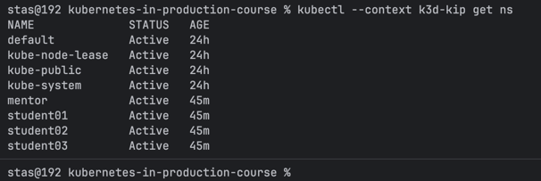
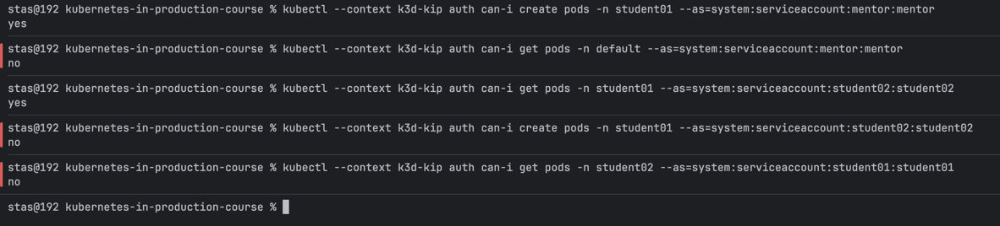
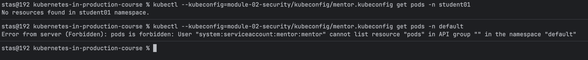
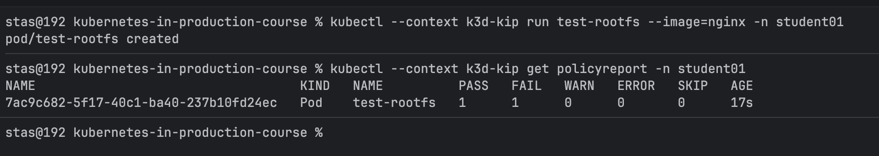
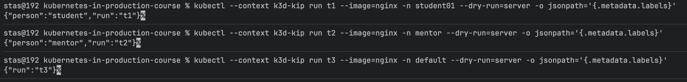

# Module 02 – Security & Policy as Code

Cluster: `k3d-kip` (local k3d, 1 server + 2 agents, k3s v1.35.5). A single
cluster — separation between the mentor and the students is implemented via
namespaces + RBAC, not separate clusters.

## 1. Cluster, namespaces, kubeconfig, RBAC

4 namespaces created: `mentor`, `student01`, `student02`, `student03` (plus
the already existing `default`).

```bash
kubectl --context k3d-kip apply -f module-02-security/namespaces.yaml
```

Each person has their own ServiceAccount
([`service-accounts.yaml`](./service-accounts.yaml)) and their own kubeconfig
file, generated via [`scripts/generate-kubeconfigs.sh`](./scripts/generate-kubeconfigs.sh)
(ServiceAccount token auth — no external IAM/OIDC available on a local
cluster). Files are not committed to git (see `.gitignore`).

RBAC is implemented with two reusable `ClusterRole` templates
([`rbac-cluster-roles.yaml`](./rbac-cluster-roles.yaml): `ns-read-write`,
`ns-read-only`) bound per-namespace via `RoleBinding`
([`rbac-mentor.yaml`](./rbac-mentor.yaml), [`rbac-students.yaml`](./rbac-students.yaml)).
No `ClusterRoleBinding` is created anywhere, so no one has cluster-admin.

### Access matrix

| Who | mentor ns | student01 ns | student02 ns | student03 ns | default ns |
|---|---|---|---|---|---|
| mentor | - | RW | RW | RW | - |
| student01 | - | RW | - | - | - |
| student02 | - | RO | RW | - | RO |
| student03 | - | - | - | RW | - |

### Verification

```bash
kubectl --context k3d-kip apply -f module-02-security/rbac-cluster-roles.yaml
kubectl --context k3d-kip apply -f module-02-security/rbac-mentor.yaml
kubectl --context k3d-kip apply -f module-02-security/rbac-students.yaml

kubectl --context k3d-kip auth can-i create pods -n student01 --as=system:serviceaccount:mentor:mentor
kubectl --context k3d-kip auth can-i get pods -n default --as=system:serviceaccount:mentor:mentor
kubectl --context k3d-kip auth can-i get pods -n student01 --as=system:serviceaccount:student02:student02
kubectl --context k3d-kip auth can-i create pods -n student01 --as=system:serviceaccount:student02:student02
kubectl --context k3d-kip auth can-i get pods -n student02 --as=system:serviceaccount:student01:student01
```





Personal kubeconfig also confirmed to work end-to-end (mentor can read/write
in `student01`, gets `Forbidden` in `default`):



All 4 kubeconfig files (mentor + 3 students) were tested the same way and
match the access matrix above.

## 2. Kyverno policy: readonly root filesystem (audit)

Validates that every container sets `securityContext.readOnlyRootFilesystem: true`,
in **audit mode** — violations are reported, pods are not blocked
(`validationFailureAction: Audit`). `match` targets `kind: Pod`; Kyverno's
autogen feature automatically applies the same rule to Deployment/StatefulSet/
DaemonSet/Job/CronJob.

Manifest: [`kyverno-readonly-rootfs-audit.yaml`](./kyverno-readonly-rootfs-audit.yaml)

```bash
helm install kyverno kyverno/kyverno -n kyverno-system --create-namespace --kube-context k3d-kip
kubectl --context k3d-kip apply -f module-02-security/kyverno-readonly-rootfs-audit.yaml

kubectl --context k3d-kip run test-rootfs --image=nginx -n student01
kubectl --context k3d-kip get policyreport -n student01
```

```
$ kubectl --context k3d-kip get policyreport -n student01
NAME                                   KIND   NAME          PASS   FAIL   WARN   ERROR   SKIP   AGE
fd8e44e7-1457-4a34-8778-1855c1fba000   Pod    test-rootfs   0      1      0      0       0      41s
```

Pod created (not blocked) + violation recorded in `PolicyReport` = audit mode
working as required.



## 3. Kyverno policy: "person" label

Mutates pods to add a `person` label based on namespace: student namespaces
get `person: student`, `mentor` gets `person: mentor`, every other namespace
gets no `person` label at all (two explicit-allowlist rules, no catch-all).

Manifest: [`kyverno-person-label.yaml`](./kyverno-person-label.yaml)

```bash
kubectl --context k3d-kip apply -f module-02-security/kyverno-person-label.yaml

kubectl --context k3d-kip run t1 --image=nginx -n student01 --dry-run=server -o jsonpath='{.metadata.labels}'
kubectl --context k3d-kip run t2 --image=nginx -n mentor --dry-run=server -o jsonpath='{.metadata.labels}'
kubectl --context k3d-kip run t3 --image=nginx -n default --dry-run=server -o jsonpath='{.metadata.labels}'
```

```
{"person":"student","run":"t1"}   # student01
{"person":"mentor","run":"t2"}    # mentor
{"run":"t3"}                      # default — no person label
```


