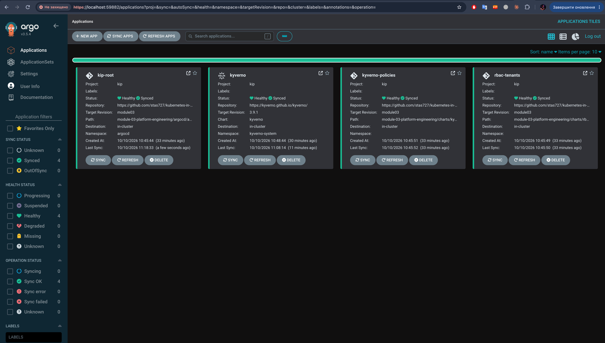
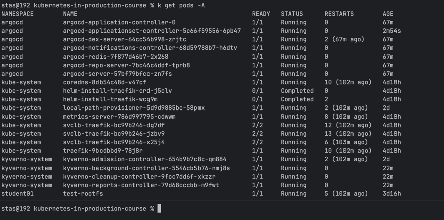
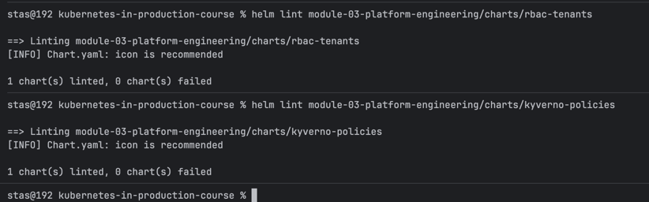

# Module 03 – Platform Engineering

Cluster: **`k3d-kip`** only. All commands below are run manually, with
explicit approval, against `--context k3d-kip`.

## 1. GitOps (ArgoCD)

ArgoCD installed into `k3d-kip` via the official install manifest:

```bash
kubectl --context k3d-kip create namespace argocd
kubectl --context k3d-kip apply --server-side -n argocd \
  -f https://raw.githubusercontent.com/argoproj/argo-cd/stable/manifests/install.yaml
```

> Use `--server-side`: client-side apply fails on ArgoCD's own
> `applicationsets.argoproj.io` CRD (`last-applied-configuration` annotation
> exceeds the 256KB limit). Same reason the `kyverno` Application below needs
> `ServerSideApply=true` in its `syncOptions`.

Layout:

- `argocd/projects/kip-project.yaml` — `AppProject kip`, scoped to this
  cluster only, whitelisting just the cluster-scoped kinds actually used
  (`Namespace`, `ClusterRole`, `ClusterRoleBinding`, `ClusterPolicy`, plus the
  CRDs/webhooks Kyverno's chart installs). Applied once, manually.
- `argocd/applications/kyverno.yaml` — official Kyverno Helm chart
  (`https://kyverno.github.io/kyverno/`), so Kyverno itself is under GitOps
  too, not just our policies.
- `argocd/applications/rbac-tenants.yaml` /
  `kyverno-policies.yaml` — our two charts (below), pointing at this repo.
- `argocd/root-app.yaml` — app-of-apps: one `Application` pointing at
  `argocd/applications/`, which creates the three Applications above.

Apply order:

```bash
kubectl --context k3d-kip apply -f module-03-platform-engineering/argocd/projects/kip-project.yaml
kubectl --context k3d-kip apply -f module-03-platform-engineering/argocd/root-app.yaml
```

### Result



```bash
kubectl --context k3d-kip -n argocd get pods
kubectl --context k3d-kip -n kyverno-system get pods
```



## 2. Module 02 policies rewritten as Helm charts

### `charts/rbac-tenants`

Namespaces + ServiceAccounts + ClusterRoles (`ns-read-write`, `ns-read-only`)
+ RoleBindings — same result as `module-02-security/*.yaml`, templated from
`values.yaml`. The access matrix (who's RW/RO where) is data
(`students[].access.rw/ro`), not hardcoded manifests.

### `charts/kyverno-policies`

The two `ClusterPolicy` objects (readonly-rootfs audit, `person` label
mutation), also templated from `values.yaml`.

```bash
helm lint module-03-platform-engineering/charts/rbac-tenants
helm lint module-03-platform-engineering/charts/kyverno-policies
helm template rbac-tenants module-03-platform-engineering/charts/rbac-tenants
helm template kyverno-policies module-03-platform-engineering/charts/kyverno-policies
```

Both render output identical to the original Module 02 manifests.


