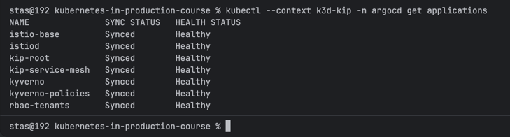
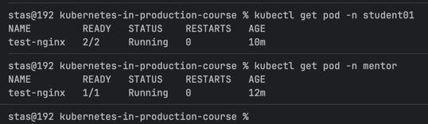
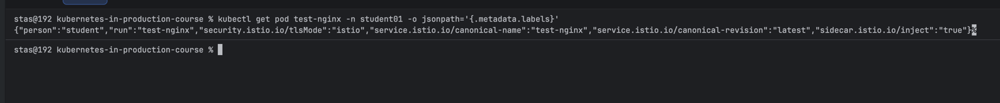

# Module 04 – Service Mesh

## 1. Istio (sidecar mode) via ArgoCD

- `argocd/applications/istio-base.yaml` — official `istio/base` chart
  (CRDs), sync-wave 0.
- `argocd/applications/istiod.yaml` — official `istiod` chart (control
  plane), sync-wave 1. Sidecar mode is the chart's own default — no ambient
  profile, no ztunnel.
- `argocd/root-app.yaml` — app-of-apps `kip-service-mesh`, creates the two
  Applications above.

## 2. Sidecar injection scoped to `person: student`

Two independent gates, both required:

1. **Namespace-level** — `student01`/`02`/`03` get the `istio-injection:
   enabled` label (via `rbac-tenants`'s `meshInjection.enabled` /
   `meshInjection.students`). `mentor` does **not** get this label —
   Istio's webhook never looks at pods there at all.
2. **Pod-level** — a third rule added to the existing `add-person-label`
   Kyverno `ClusterPolicy` (`charts/kyverno-policies`, flag
   `istioInjectionLabel.enabled`): once a pod already carries `person:
   student` (set by the first rule in the same policy), a `preconditions`
   check adds `sidecar.istio.io/inject: "true"`.

Allowlist, not denylist: the rule matches `person == student` explicitly —
a pod with no `person` label, or `person: mentor`, never matches, so it's
safe by default.

Test pods used for verification: `test-pods/student-pod.yaml`,
`test-pods/mentor-pod.yaml`.

## Result



```bash
kubectl get pod -n student01
kubectl get pod -n mentor
```



```bash
kubectl get pod test-nginx -n student01 -o jsonpath='{.metadata.labels}'
```


