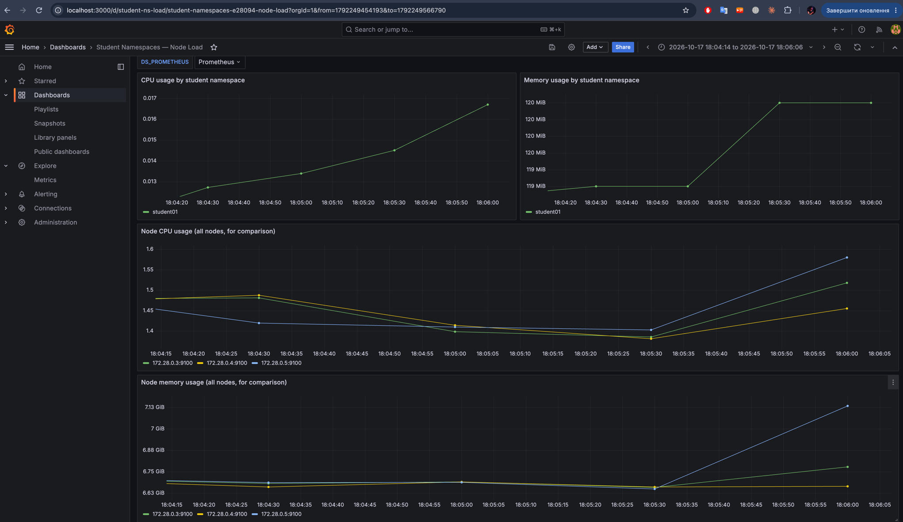
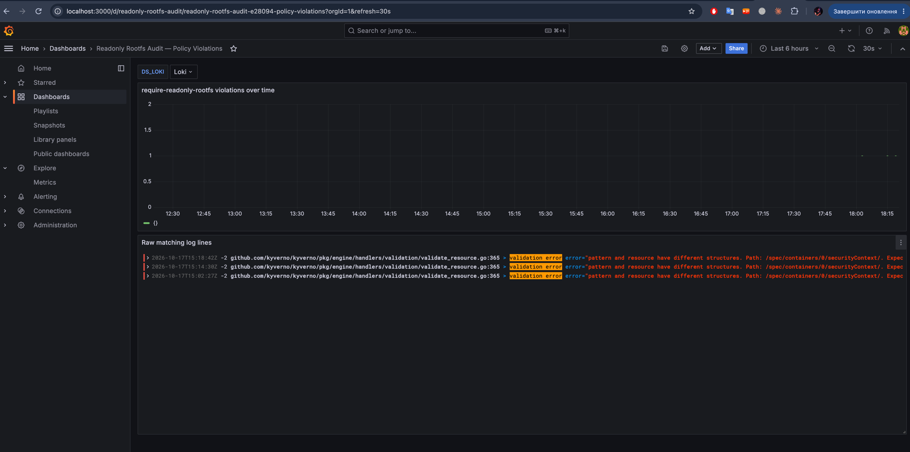
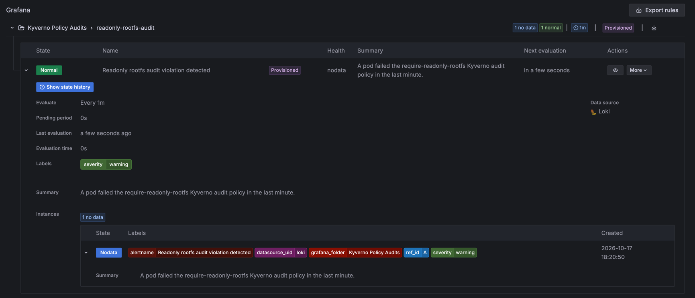
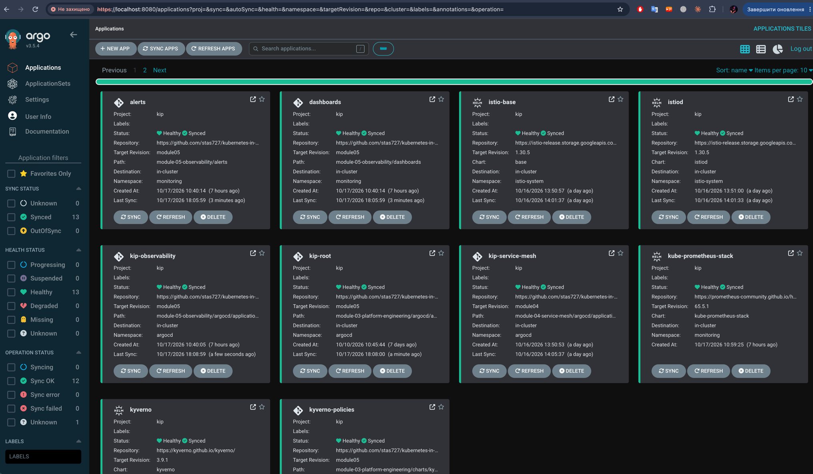
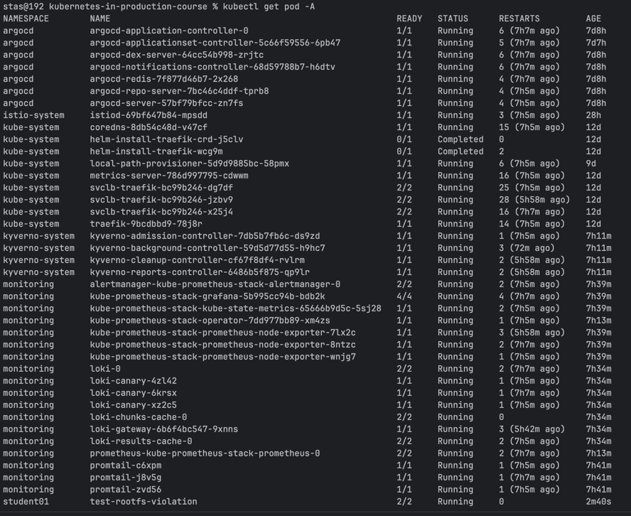

# Module 05 - Observability & Troubleshooting

## 1. Monitoring stack

- `argocd/applications/kube-prometheus-stack.yaml` - official `kube-prometheus-stack` chart (Prometheus, Grafana, Alertmanager, node-exporter, kube-state-metrics).
- `argocd/applications/loki.yaml` - Loki (single-binary mode, filesystem storage).
- `argocd/applications/promtail.yaml` - Promtail DaemonSet, ships every node's container logs to Loki.
- `argocd/root-app.yaml` - app-of-apps `kip-observability`, creates all Applications above plus `dashboards`/`alerts`.
- `dashboards/loki-datasource.yaml` - wires Loki into Grafana with a pinned `uid: loki` (stable across reinstalls, referenced by the alert rule below).

## 2. Node load dashboard, per student namespace

`dashboards/student-namespaces-load.yaml` - Grafana dashboard (auto-imported via Grafana's ConfigMap sidecar): CPU and memory usage grouped by `student01`/`02`/`03`, plus per-node totals for comparison. Backed by Prometheus (`container_cpu_usage_seconds_total`, `container_memory_working_set_bytes`, `node_cpu_seconds_total`, `node_memory_*`).

## 3. Readonly-rootfs audit: dashboard + alert

Kyverno's `require-readonly-rootfs` policy (module-02/03) runs in Audit mode - it never blocks a pod, it only records the violation. The only place that record is visible as a log line is the `kyverno-admission-controller` pod's stdout, and only once verbosity is raised - `module-03-platform-engineering/argocd/applications/kyverno.yaml` sets `features.logging.verbosity: 3`, which is what actually emits one `validation error` line per failed resource.

- `dashboards/readonly-rootfs-audit.yaml` - Grafana dashboard querying Loki for that line (`{component="admission-controller"} |= "validation error" |= "require-readonly-rootfs"`): a violations-over-time graph plus the raw matching log lines.
- `alerts/readonly-rootfs-audit-alert.yaml` - Grafana alert rule on the same Loki query, evaluated every minute. The query returns a time series, so the rule chains three steps: the raw Loki query, then a `reduce` (sum), then a `threshold` (> 0) - Grafana alerting requires a single reduced value before it can threshold.
- `test-pods/rootfs-violation-pod.yaml` - a plain pod (no `readOnlyRootFilesystem`) used to trigger the policy and verify the whole chain end to end.

## Result

